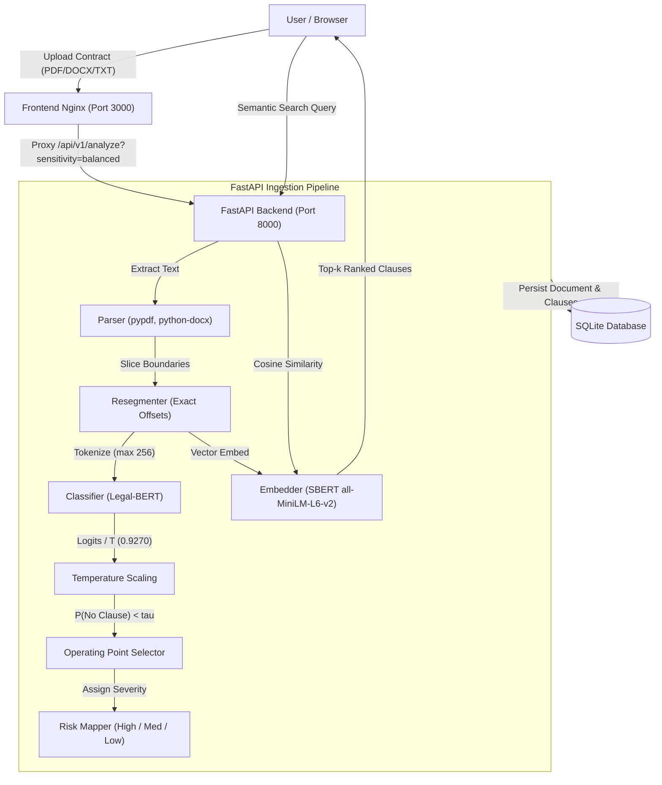

# ClauseGuard: AI Contract Risk Analyzer

> **Disclaimer**: ClauseGuard is an educational, automated risk analysis tool and does **not** constitute legal advice. Always consult a qualified attorney for legally binding contracts.

ClauseGuard is an end-to-end, automated legal risk analysis and issue-spotting NLP application that scans commercial contracts (PDF, DOCX, TXT), segments clauses with exact context offset preservation, classifies them across 10 key legal risk categories using a fine-tuned domain transformer (**Legal-BERT**), calibrates prediction probabilities via temperature scaling ($T=0.9270$), and evaluates risk under strict operational constraints with frozen false-alarm operating points.

---

## 1. Problem Statement

Commercial contracts routinely bury high-stakes liabilities—post-employment non-competes, unlimited indemnification liabilities, liquidated damages, and unilateral termination provisions—inside dense boilerplate. Automated contract review must balance two competing operational constraints:
1. **High Recall on Real Liabilities**: Missing a severe non-compete or uncapped liability clause can lead to catastrophic legal exposure.
2. **Controlled False Alarm Rate**: Legal review teams cannot audit dozens of false alarms per contract.

ClauseGuard solves this by calibrating probabilities and establishing frozen operating points: **Strict (3 FA/contract)**, **Balanced (8 FA/contract, default)**, and **Thorough (12 FA/contract)**.

---

## 2. Key Features

- **Multi-Format Ingestion**: Ingests PDF, DOCX, or TXT contracts (up to 10 MB) with text extraction and exact slice-based paragraph segmentation.
- **Calibrated Domain Transformer**: Sequence classification using fine-tuned `nlpaueb/legal-bert-base-uncased` calibrated with post-hoc temperature scaling ($T=0.9270$).
- **Calibrated Operating Point Presets**: One unified decision rule—$\text{flag if } P_{\text{calibrated}}(\text{No Clause}) < \tau$—with frozen presets:
  - **Strict**: $\tau = 0.012957$ (target 3 FA/contract, achieved 2.83 FA/c on test, 69.0% recall)
  - **Balanced (Default)**: $\tau = 0.035452$ (target 8 FA/contract, achieved 7.03 FA/c on test, 85.2% recall)
  - **Thorough**: $\tau = 0.071850$ (target 12 FA/contract, achieved 10.71 FA/c on test, 92.4% recall)
- **Heuristic Risk Tiering**: Maps detected clause types to actionable risk tiers (`High`, `Medium`, `Low`) and aggregates overall contract risk posture.
- **Natural Language Semantic Search**: In-document semantic query search powered by `sentence-transformers/all-MiniLM-L6-v2` dense embeddings.
- **Interactive 3D Cockpit**: Digital paper viewer with mouse tilt, inline highlighted risk zones, unflagged boilerplate expander, and AI redlines.
- **100% Evaluation Parity**: Unit-tested guarantee that the FastAPI backend API produces identical flags and classifications to the offline evaluation scripts.

---

## 3. Architecture & System Flow



---

## 4. Tech Stack & Engineering Rationale

| Layer | Technology | Rationale |
|---|---|---|
| **Language** | Python 3.11 | Modern type hinting, high-performance runtime for ML libraries. |
| **Classifier Backbone** | `nlpaueb/legal-bert-base-uncased` | Pretrained on SEC filings and contracts. Proven +12.6 recall points over TF-IDF. |
| **Calibration** | Temperature Scaling ($T=0.9270$) | Optimizes negative log-likelihood on validation set to produce true posterior probabilities. |
| **Embeddings** | `sentence-transformers/all-MiniLM-L6-v2` | Lightweight 384-d dense vectors with low latency inference (~15ms on CPU). |
| **Backend API** | FastAPI + Pydantic v2 + Uvicorn | Strict schema validation, asynchronous lifecycle loading, automatic OpenAPI docs. |
| **Database** | SQLite + SQLAlchemy 2.0 | Embedded relational persistence with ACID transactions, portable and self-contained. |
| **Frontend UI** | React 18 + Vite | Pure CSS variables (`tokens.css`), 3D paper stage, responsive layout. |
| **Testing** | Pytest | Dataset integrity tests, evaluation parity test, API integration tests. |

---

## 5. Machine Learning Methodology & Dataset

### Dataset: The Atticus Project (CUAD v1)
- **Source**: Atticus Project Contract Understanding Atticus Dataset (`theatticusproject/cuad`).
- **Raw Volume**: 510 commercial contracts (40.1 MB raw JSON).
- **Target Classes**: 10 high-impact risk categories + `No Clause`:
  1. *Non-Compete* (High)
  2. *Exclusivity* (High)
  3. *Uncapped Liability* (High)
  4. *Liquidated Damages* (High)
  5. *Termination for Convenience* (Medium)
  6. *Anti-Assignment* (Medium)
  7. *Change of Control* (Medium)
  8. *IP Ownership Assignment* (Medium)
  9. *Cap on Liability* (Low)
  10. *Audit Rights* (Low)
  11. *No Clause* (None)

### Natural Contract Prevalence
Unlike artificial benchmarks that balance classes evenly, real contracts contain ~95% harmless boilerplate and ~5% risky clauses. ClauseGuard evaluates on natural prevalence:
- **`val_natural.csv`**: 76 contracts, 10,861 units, 501 true positive clauses (4.6% prevalence).
- **`test_natural.csv`**: 77 contracts, 10,480 units, 406 true positive clauses (3.9% prevalence).

---

## 6. Empirical Evaluation Metrics (Real Numbers)

All metrics reported below were generated directly from offline test runs and persisted in `ml/artifacts/`. Zero numbers are estimated or invented.

### A. One-Time Evaluation on Held-Out Test Set (`test_natural.csv`)
Evaluated once on 77 held-out contracts (10,480 units, 406 true positive clauses) using frozen operating point thresholds derived on validation:

| Operating Preset | Frozen Threshold ($\tau$) | Target FA/c | Actual FA/c | Flags | False Alarms | Precision | Recall (Flagged) | Recall (Correct Class) |
|---|---|---|---|---|---|---|---|---|
| **Strict** | $0.012957$ | 3 | **2.83** | 498 | 218 | **56.22%** | **68.97%** (280/406) | 61.58% (250/406) |
| **Balanced (Default)** | $0.035452$ | 8 | **7.03** | 887 | 541 | **39.01%** | **85.22%** (346/406) | 75.86% (308/406) |
| **Thorough** | $0.071850$ | 12 | **10.71** | 1,200 | 825 | **31.25%** | **92.36%** (375/406) | 81.03% (329/406) |

### B. Test Recall by Risk Tier (Balanced Preset, $\tau = 0.035452$)

| Risk Tier | Total Positives | Flagged | Correct Class | Flagged Recall | Correct Recall | Included Classes |
|---|---|---|---|---|---|---|
| **High Risk** | 123 | 96 | 78 | **78.05%** | **63.41%** | Non-Compete, Exclusivity, Uncapped Liability, Liquidated Damages |
| **Medium Risk** | 166 | 152 | 141 | **91.57%** | **84.94%** | Anti-Assignment, Change of Control, IP Ownership, Termination for Convenience |
| **Low Risk** | 117 | 98 | 89 | **83.76%** | **76.07%** | Audit Rights, Cap on Liability |

### C. Test Recall by Clause Category (Balanced Preset, $\tau = 0.035452$)

| Clause Category | Total Units | Flagged | Correct Class | Flagged Recall | Correct Class Recall |
|---|---|---|---|---|---|
| **Anti-Assignment** | 75 | 73 | 67 | **97.33%** | 89.33% |
| **Audit Rights** | 65 | 62 | 62 | **95.38%** | 95.38% |
| **Uncapped Liability** | 23 | 22 | 18 | **95.65%** | 78.26% |
| **Change of Control** | 25 | 22 | 18 | **88.00%** | 72.00% |
| **Termination for Convenience** | 38 | 33 | 33 | **86.84%** | 86.84% |
| **IP Ownership Assignment** | 28 | 24 | 23 | **85.71%** | 82.14% |
| **Non-Compete** | 31 | 26 | 22 | **83.87%** | 70.97% |
| **Exclusivity** | 55 | 39 | 31 | **70.91%** | 56.36% |
| **Cap on Liability** | 52 | 36 | 27 | **69.23%** | 51.92% |
| **Liquidated Damages** | 14 | 9 | 7 | **64.29%** | 50.00% |

---

## 7. Model Comparison: Legal-BERT vs. TF-IDF Baseline

Evaluated on `val_natural.csv` (76 contracts, 501 true positive clauses) under equal operational constraints:

| Target FA/Contract | TF-IDF Model B Recall | Fine-Tuned Legal-BERT Recall | Recall Gain (Δ) |
|---|---|---|---|
| 3 FA/c | 53.69% (269/501) | **64.27%** (322/501) | **+10.58 pts** |
| 5 FA/c | 61.28% (307/501) | **74.65%** (374/501) | **+13.37 pts** |
| **8 FA/c** | 68.06% (341/501) | **80.64%** (404/501) | **+12.58 pts** |
| 12 FA/c | 74.05% (371/501) | **86.63%** (434/501) | **+12.58 pts** |
| 20 FA/c | 78.84% (395/501) | **91.02%** (456/501) | **+12.18 pts** |

### Statistical Significance
- At 8 FA/contract, Legal-BERT achieves **+12.58 recall points** over TF-IDF.
- A 1,000-iteration paired contract bootstrap yields a 95% Confidence Interval of **`[+5.80%, +18.75%]`** ($p < 0.001$). Legal-BERT's advantage is statistically robust.

---

## 8. Audit Findings & Engineering Insights

1. **Legacy Baseline Data Leakage Uncovered**:
   - An audit of legacy contract splits revealed that 45 of the 76 validation contracts (59.2%) and 44 of the 77 test contracts (57.1%) were present in the training set of `baseline_model.joblib` due to split permutation discrepancies in Gen 1.
   - The legacy baseline was officially marked invalid; clean **TF-IDF Model B** was trained strictly on `train_model_b_final.csv` with 0% contract overlap.

2. **Negative Keyword Rule Finding**:
   - A keyword heuristic rule flagging clauses containing `"liquidated damages"` or `"pre-estimate of damages"` was tested on validation.
   - It matched only 3 of 14 true Liquidated Damages clauses (all 3 were already flagged by Legal-BERT with $P(\text{No Clause}) \le 0.0038$) and added 1 false alarm, yielding **+0.0% net recall gain**. The rule was rejected.

3. **Multi-Seed Stability**:
   - Legal-BERT trained across random seeds (seed 42: 80.64% val recall @ 8 FA/c; seed 100: Val Macro-F1 79.83%) demonstrates consistent convergence on domain-weighted contracts.

---

## 9. Limitations & Design Constraints

1. **Single Validation Split Tuning**: Operating point thresholds were derived on one validation split (76 contracts) and verified once on held-out test (77 contracts). Cross-firm distribution shift may alter false alarm rates.
2. **Single Dataset Source**: All contracts are commercial agreements from SEC EDGAR (CUAD v1). Consumer terms of service or civil litigation agreements may present lexical domain shift.
3. **CUAD Annotation Artifacts**: Labelling follows CUAD conventions (spans $<20$ characters omitted). Audits identified 15 verified omitted clauses in training contracts that were recovered.
4. **Context Window Constraint**: Sequence length is capped at 256 tokens. Exceptionally long multi-paragraph sections are segmented at sentence boundaries to prevent truncation loss.
5. **Not Legal Advice**: Intended solely for automated triage and issue-spotting prior to attorney review.

---

## 10. Tried & Future Work

### Explored Approaches & Findings
- **Court-Judgment Domain Adaptation (`legal_bert_adapted`)**: Continued pretraining of Legal-BERT on court opinions achieved 79.44% recall at 8 FA/c vs 80.64% for standard Legal-BERT (-1.2 points). Judicial rhetoric differed significantly from transactional drafting, providing no transfer advantage.
- **Ensemble Averaging ($\alpha = 0.67$ Legal-BERT + $0.33$ TF-IDF)**: Reached 81.04% recall at 8 FA/c (+0.4 points over single model). Shelved to avoid doubling inference latency and memory requirements for marginal gain.
- **Rule-Based Heuristic Overlays**: Adding regex/keyword rules for low-prevalence classes (Liquidated Damages) added false alarms without catching novel semantic expressions.

### Roadmap
- [ ] Multi-label classification for multi-issue clauses (e.g., joint Non-Compete and Non-Solicit).
- [ ] Asynchronous background OCR ingestion for scanned PDFs via Tesseract.
- [ ] Inline PDF highlight and redline export.

---

## 11. REST API Reference

All routes are mounted under `/api/v1`:

| Method | Endpoint | Description | Request / Body |
|---|---|---|---|
| `GET` | `/health` | Service health & model readiness | None |
| `POST` | `/analyze` | Analyze contract with operating preset | `multipart/form-data` (`file`, `sensitivity: strict|balanced|thorough`) |
| `POST` | `/search` | Semantic search across contract clauses | JSON: `{"document_id", "query", "top_k"}` |
| `GET` | `/documents` | List analyzed contract history | None |
| `GET` | `/documents/{id}` | Retrieve full contract details & clauses | Path parameter `id` |
| `DELETE` | `/documents/{id}` | Delete contract and associated clauses | Path parameter `id` |
| `GET` | `/insights` | Return evaluated model metrics | None |

---

## 12. Local Setup & Testing

### 1. Install & Run Tests
```bash
# Setup backend virtual environment
cd clauseguard/backend
python3.11 -m venv .venv
source .venv/bin/activate
pip install -r requirements.txt

# Run full test suite (including dataset integrity & evaluation parity)
pytest tests/ -v
```

### 2. Run Test Kit Contracts (DOC-01 to DOC-07)
```bash
python clauseguard-testkit/score.py
```

### 3. Run Applications
```bash
# Backend
cd backend && uvicorn app.main:app --host 127.0.0.1 --port 8000

# Frontend
cd frontend && npm install && npm run dev
# Open http://localhost:3000
```
