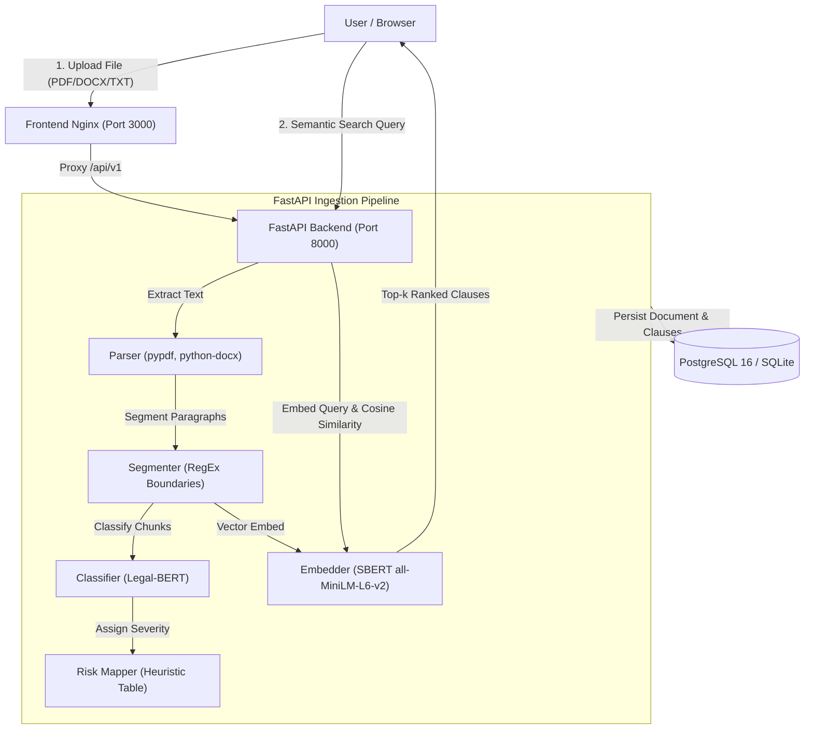

# ClauseGuard: AI Contract Risk Analyzer

> **Disclaimer**: ClauseGuard is an educational, automated risk analysis tool and does **not** constitute legal advice. Always consult a qualified attorney for legally binding contracts.

ClauseGuard is an end-to-end, production-grade NLP application that scans legal contracts (PDF, DOCX, TXT), segments clauses, classifies them into 10 key legal clause types using a fine-tuned domain-specific transformer (**Legal-BERT**), maps each clause to an empirical risk level (High / Medium / Low), and provides plain-English semantic search via Sentence-BERT.

---

## 1. Problem Statement

Individuals, freelancers, and small business operators frequently sign standard contracts without legal review. Severe risk provisions—including post-employment non-competes, uncapped indemnification liabilities, liquidated damages, and unilateral termination terms—are routinely buried within complex, dense legalese. ClauseGuard automates first-pass contract risk triage to identify high-risk exposure before signature.

---

## 2. Key Features

- **Multi-Format Ingestion**: Upload PDF, DOCX, or TXT contracts (up to 10 MB) with text extraction and automatic clause segmentation.
- **Domain Transformer Classification**: Sequence classification across 10 core legal categories + "No Clause" using `nlpaueb/legal-bert-base-uncased`.
- **Heuristic Risk Scoring**: Maps detected clause types to actionable risk tiers (`High`, `Medium`, `Low`) and aggregates overall contract risk posture.
- **Natural Language Semantic Search**: In-document semantic query search powered by `sentence-transformers/all-MiniLM-L6-v2` embeddings and cosine similarity.
- **Document History & Inspection**: Full audit trail backed by PostgreSQL/SQLite with cascade deletion and clause-level inspection.
- **Model Insights Dashboard**: Transparent, verifiable model metrics comparing TF-IDF baseline vs. Legal-BERT, complete with confusion matrix visualizations.
- **Fully Containerized & Production-Ready**: Multi-stage Dockerfiles with CPU-optimized PyTorch wheels, health checks, and environment-driven configurations.

---

## 3. UI Screenshots & Walkthrough

| Analyze View | Results & Risk Badges | Semantic Search |
|---|---|---|
|  |  |  |

| Document History | Model Insights Dashboard |
|---|---|
|  |  |

---

## 4. Architecture & System Flow




---

## 4. Tech Stack & Engineering Rationale

| Layer | Technology | Rationale |
|---|---|---|
| **Language** | Python 3.11 | Modern type hinting, high-performance runtime for ML libraries. |
| **Classifier Model** | `nlpaueb/legal-bert-base-uncased` | Pretrained on SEC EDGAR filings, contracts, and court cases. Outperforms general BERT on legal lexicon. |
| **Embeddings** | `sentence-transformers/all-MiniLM-L6-v2` | Lightweight 384-d dense vectors with low latency inference (~15ms on CPU). |
| **Backend API** | FastAPI + Pydantic v2 + Uvicorn | Strict schema validation, asynchronous lifecycle loading, automatic OpenAPI docs. |
| **Database** | PostgreSQL 16 + SQLAlchemy 2.0 | Typed relational schemas, ACID transactions, portable to SQLite for testing. |
| **Frontend UI** | React 18 + Vite | Pure CSS variables (`tokens.css`), responsive layout, no bulky UI frameworks. |
| **Testing** | Pytest + HTTPX (Async/Sync) | Unit testing for text parsers/segmenters and integration tests for API endpoints. |
| **Deployment** | Docker & Docker Compose | Self-contained, multi-stage builds with CPU-optimized PyTorch wheels. |

---

## 5. Machine Learning Methodology & Real Dataset

### Dataset: The Atticus Project (CUAD v1)
- **Source**: Atticus Project Contract Understanding Atticus Dataset (`theatticusproject/cuad`).
- **Raw Volume**: 510 commercial contracts (40.1 MB raw JSON).
- **Target Classes**: 10 high-impact risk categories + `No Clause`:
  1. *Non-Compete* (High)
  2. *Exclusivity* (High)
  3. *Uncapped Liability* (High)
  4. *Liquidated Damages* (High)
  5. *Termination for Convenience* (Medium)
  6. *Anti-Assignment* (Medium)
  7. *Change of Control* (Medium)
  8. *IP Ownership Assignment* (Medium)
  9. *Cap on Liability* (Low)
  10. *Audit Rights* (Low)
  11. *No Clause* (None)

### Preprocessing & Leakage Prevention
- **Contract-Level Split**: Split strictly by contract (70% train / 15% val / 15% test) with fixed seed `42`. **Zero contract overlap** across splits.
- **Downsampling**: "No Clause" class downsampled from 63,357 to 891 (3x average positive class frequency) to counteract extreme imbalance.
- **Split Sizes**:
  - **Train**: 2,751 clauses across 323 contracts
  - **Validation**: 482 clauses across 69 contracts
  - **Test**: 636 clauses across 70 contracts

---

## 6. Real Model Evaluation Metrics

All numbers below were produced by evaluating models on the held-out test split (636 clauses from 70 contracts):

### Overall Test Performance

| Metric | Baseline (TF-IDF + LogReg) | Fine-Tuned Legal-BERT | Delta (Δ) |
|---|---|---|---|
| **Accuracy** | 75.16% | **76.42%** | **+1.26%** |
| **Macro F1** | **73.01%** | 72.77% | -0.24% |
| **Macro Precision** | 72.24% | **72.50%** | **+0.26%** |
| **Macro Recall** | **75.26%** | 74.65% | -0.61% |

### Per-Class Test Breakdown (Legal-BERT)

| Clause Category | Precision | Recall | F1 Score | Test Support | Risk Tier |
|---|---|---|---|---|---|
| **Anti-Assignment** | 89.02% | 80.22% | **0.8439** | 91 | Medium |
| **Audit Rights** | 90.67% | 75.56% | **0.8242** | 90 | Low |
| **IP Ownership Assignment** | 79.07% | 89.47% | **0.8395** | 38 | Medium |
| **No Clause** | 83.89% | 75.76% | **0.7962** | 165 | None |
| **Termination for Convenience** | 65.71% | 88.46% | **0.7541** | 26 | Medium |
| **Exclusivity** | 71.64% | 77.42% | **0.7442** | 62 | High |
| **Cap on Liability** | 63.41% | 81.25% | **0.7123** | 64 | Low |
| **Liquidated Damages** | 64.71% | 64.71% | **0.6471** | 17 | High |
| **Non-Compete** | 55.26% | 75.00% | **0.6364** | 28 | High |
| **Uncapped Liability** | 78.95% | 51.72% | **0.6250** | 29 | High |
| **Change of Control** | 55.17% | 61.54% | **0.5818** | 26 | Medium |

---

## 7. REST API Reference

All routes are mounted under `/api/v1`:

| Method | Endpoint | Description | Request / Body |
|---|---|---|---|
| `GET` | `/health` | Liveness & readiness check | None |
| `POST` | `/analyze` | Analyze contract file | `multipart/form-data` (`file`) |
| `POST` | `/search` | Natural language semantic search | JSON: `{"document_id", "query", "top_k"}` |
| `GET` | `/documents` | List analyzed contract history | None |
| `GET` | `/documents/{id}` | Retrieve full contract details & clauses | Path parameter `id` |
| `DELETE` | `/documents/{id}` | Delete contract and associated clauses | Path parameter `id` |
| `GET` | `/insights` | Return evaluated model metrics | None |
| `GET` | `/static/{filename}` | Serve generated confusion matrices & EDA plots | Static filename |

---

## 8. Local Setup & Execution

### Prerequisites
- Python 3.11
- Node.js v20+
- Git

### 1. Clone & Setup Python Environments
```bash
git clone https://github.com/your-username/clauseguard.git
cd clauseguard

# Setup Backend Environment
cd backend
python3.11 -m venv .venv
source .venv/bin/activate
pip install -r requirements.txt
cd ..

# Setup ML Environment
cd ml
python3.11 -m venv .venv
source .venv/bin/activate
pip install -r requirements.txt
cd ..
```

### 2. Run Backend
```bash
cd backend
source .venv/bin/activate
uvicorn app.main:app --host 127.0.0.1 --port 8000
```

### 3. Run Frontend
```bash
cd frontend
npm install
npm run dev
# Access UI at http://localhost:3000
```

### 4. Run Automated Backend Tests
```bash
cd backend
source .venv/bin/activate
pytest tests/ -v
# Output: 19 passed
```

---

## 9. Docker Compose Deployment

Run the entire stack (PostgreSQL, Backend API, Frontend Nginx) with a single command:

```bash
docker compose up --build -d
```
- **Frontend Application**: `http://localhost:3000`
- **Backend API**: `http://localhost:8000`
- **Interactive OpenAPI Documentation**: `http://localhost:8000/docs`

To shut down:
```bash
docker compose down -v
```

---

## 10. Limitations & Design Constraints

1. **Heuristic Risk Mapping**: Risk assignments (`High`, `Medium`, `Low`) are derived from standard legal risk heuristics, not dynamic statutory analysis.
2. **256-Token Truncation**: Sequence classification inputs are tokenized up to 256 tokens. Exceptionally lengthy paragraphs are segmented at sentence boundaries to mitigate truncation loss.
3. **No Optical Character Recognition (OCR)**: Scanned image-only PDFs without an embedded text layer return an explicit `NO_TEXT_EXTRACTED` (HTTP 422) error rather than hallucinating text.
4. **Not Legal Advice**: Intended exclusively as an educational and triage utility.

---

## 11. Future Work

- [ ] Multi-label classification for composite clauses (clauses embodying both Non-Compete and Exclusivity).
- [ ] OCR pipeline support via Tesseract for scanned paper agreements.
- [ ] Clause comparison view comparing counterparty redlines against standard baseline clauses.
- [ ] PDF inline annotation export with highlighted risk badges.
